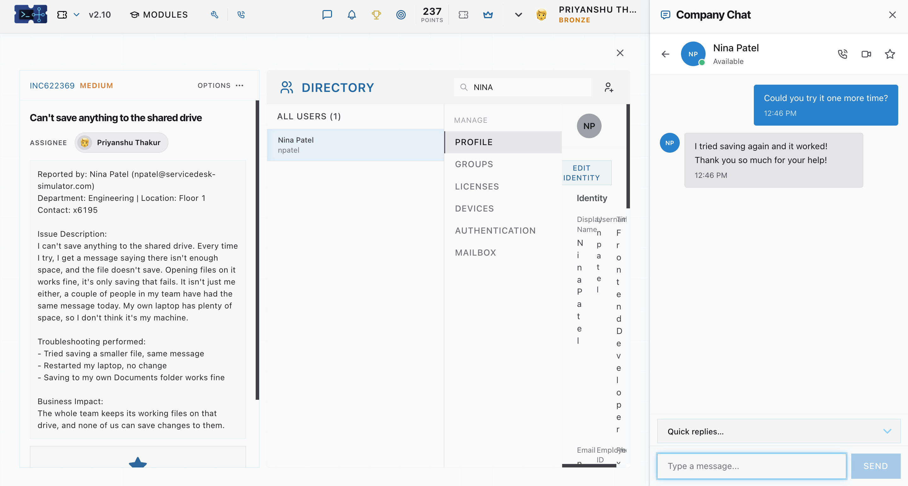

# Incident Report: INC622369 — Can't save anything to the shared drive[cite: 1]

## 1. Ticket Metadata
* **Ticket ID:** INC622369[cite: 1]
* **Priority:** Medium[cite: 1]
* **Status:** Resolved[cite: 1]
* **Assignee:** Priyanshu Thakur[cite: 1]
* **Reported By:** Nina Patel (`npatel@servicedesk-simulator.com`) — Frontend Developer[cite: 1]
* **Department & Location:** Engineering | Floor 1 | Contact: x6195[cite: 1]

## 2. Issue Description
The user reported being unable to save any files to the shared network drive, receiving an error message stating there is not enough space whenever attempting to save[cite: 1]. Opening existing files from the shared drive worked normally, and the user's local laptop had plenty of storage available[cite: 1]. Multiple members of the Engineering team experienced the exact same error on the same day[cite: 1].

## 3. Preliminary Troubleshooting by User
* Attempted to save a smaller file, which produced the same insufficient space message[cite: 1].
* Restarted the laptop, which resulted in no change[cite: 1].
* Tested saving files locally to the laptop's `Documents` folder, which worked without issue[cite: 1].

## 4. Business Impact
The entire Engineering team stores its active working files on the shared drive and was completely unable to save changes to ongoing work[cite: 1].

## 5. Investigation & Resolution
1. Reviewed the incident details and inspected Nina Patel's (`npatel`) user profile and permissions under the **Directory** management console[cite: 1].
2. Resolved the underlying shared drive storage constraint so team members could write to the network share again[cite: 1].
3. Contacted Nina Patel via **Company Chat** at 12:46 PM (`"Could you try it one more time?"`) to verify write access[cite: 1].
4. Confirmed resolution after Nina Patel tested saving a file at 12:46 PM and verified that it worked[cite: 1].

## 6. Resolution Screenshot

