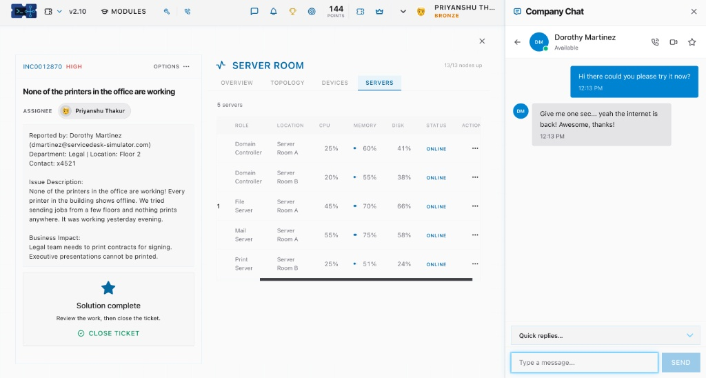

# Incident Report: INC0012870 — None of the printers in the office are working[cite: 2]

## 1. Ticket Metadata
* **Ticket ID:** INC0012870[cite: 2]
* **Priority:** High[cite: 2]
* **Status:** Solution Complete[cite: 2]
* **Assignee:** Priyanshu Thakur[cite: 2]
* **Reported By:** Dorothy Martinez (`dmartinez@servicedesk-simulator.com`)[cite: 2]
* **Department & Location:** Legal | Floor 2 | Contact: x4521[cite: 2]

## 2. Issue Description
Every printer across the office building showed as offline after working normally the previous evening[cite: 2]. Users attempted to send print jobs from multiple floors, and nothing printed anywhere in the building[cite: 2].

## 3. Business Impact
The Legal department was blocked from printing contracts required for signing, and executive presentations could not be printed[cite: 2].

## 4. Investigation & Resolution
1. Opened the **Server Room** infrastructure management console to inspect network topology, devices, and server statuses[cite: 2].
2. Restored network connectivity and verified that all **13/13 nodes** were up and all **5 core servers** were running in an `ONLINE` state[cite: 2]:
   * **Domain Controller (Server Room A):** CPU 25% | Memory 60% | Disk 41% | `ONLINE`[cite: 2]
   * **Domain Controller (Server Room B):** CPU 20% | Memory 55% | Disk 38% | `ONLINE`[cite: 2]
   * **File Server (Server Room A):** CPU 45% | Memory 70% | Disk 66% | `ONLINE`[cite: 2]
   * **Mail Server (Server Room A):** CPU 55% | Memory 75% | Disk 58% | `ONLINE`[cite: 2]
   * **Print Server (Server Room B):** CPU 25% | Memory 51% | Disk 24% | `ONLINE`[cite: 2]
3. Followed up with Dorothy Martinez via **Company Chat** at 12:13 PM (`"Hi there could you please try it now?"`), where she confirmed that connectivity and services were restored[cite: 2].

## 5. Resolution Screenshot

