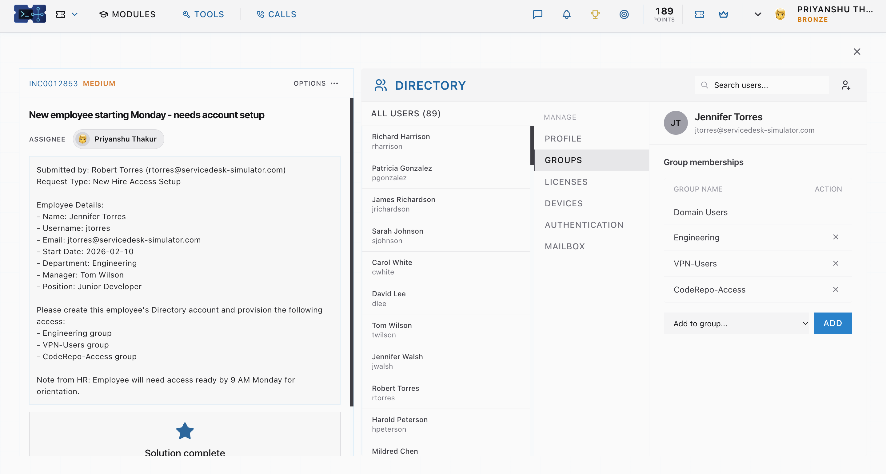

# Service Request: INC0012853 — New employee starting Monday - needs account setup[cite: 3]

## 1. Ticket Metadata
* **Ticket ID:** INC0012853[cite: 3]
* **Priority:** Medium[cite: 3]
* **Request Type:** New Hire Access Setup[cite: 3]
* **Status:** Solution Complete[cite: 3]
* **Assignee:** Priyanshu Thakur[cite: 3]
* **Submitted By:** Robert Torres (`rtorres@servicedesk-simulator.com`)[cite: 3]

## 2. New Hire Details
* **Full Name:** Jennifer Torres[cite: 3]
* **Username:** `jtorres`[cite: 3]
* **Email:** `jtorres@servicedesk-simulator.com`[cite: 3]
* **Start Date:** 2026-02-10[cite: 3]
* **Department:** Engineering[cite: 3]
* **Manager:** Tom Wilson[cite: 3]
* **Position:** Junior Developer[cite: 3]

## 3. Business Impact & SLA Requirement
Per HR notes, the employee required full account and security group access provisioned and ready before 9:00 AM Monday for new hire orientation[cite: 3].

## 4. Provisioning & Resolution Steps
1. Accessed the **Directory** administration panel (`ALL USERS`) and created the user account for **Jennifer Torres** (`jtorres@servicedesk-simulator.com`)[cite: 3].
2. Navigated to the **GROUPS** management tab under the user's Directory profile[cite: 3].
3. Provisioned the requested security and resource access groups alongside the default `Domain Users` membership[cite: 3]:
   * `Domain Users`[cite: 3]
   * `Engineering`[cite: 3]
   * `VPN-Users`[cite: 3]
   * `CodeRepo-Access`[cite: 3]
4. Verified all group memberships were active and marked the service request complete[cite: 3].

## 5. Resolution Screenshot

