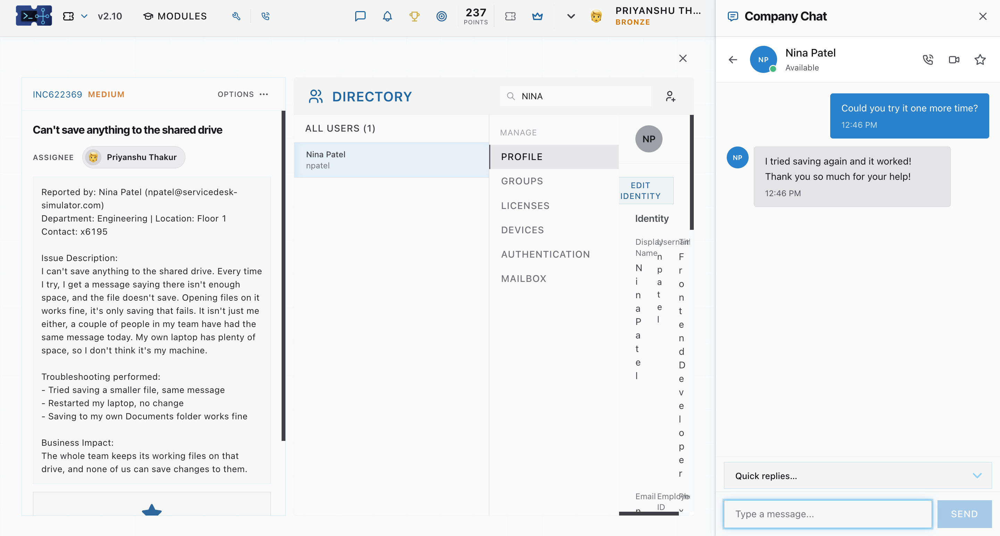
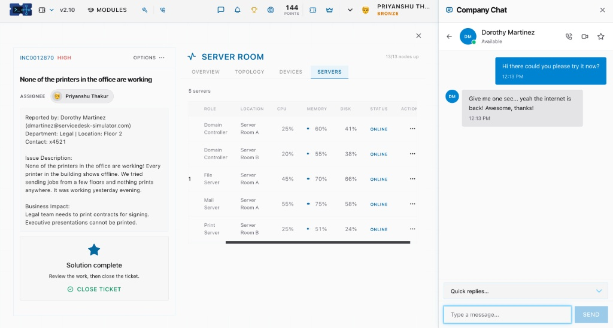
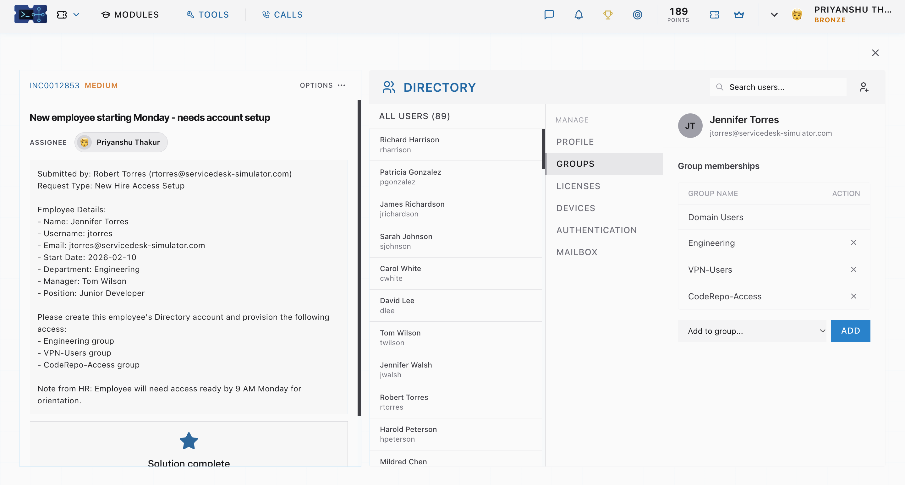
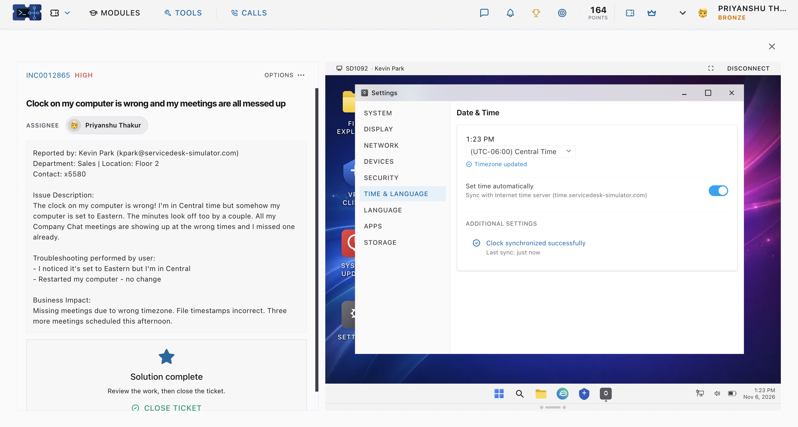

# IT Service Desk Ticketing & Troubleshooting Portfolio[cite: 6, 7]

Hands-on IT Service Desk troubleshooting portfolio by **Priyanshu Thakur** (`servicedesk-simulator.com` v2.10), documenting end-to-end incident response and service request fulfillment across Active Directory user provisioning, server room infrastructure monitoring, remote network printer administration, shared storage troubleshooting, and workstation NTP/timezone synchronization[cite: 1, 2, 3, 4, 5, 6, 7].

---

## Ticket Index & Quick Links[cite: 7]

| Ticket ID | Priority | Category | Reported By / Dept | Summary | Detailed Report |
| :--- | :--- | :--- | :--- | :--- | :--- |
| **INC622369**[cite: 1, 7] | Medium[cite: 1, 7] | Shared Storage[cite: 1, 7] | Nina Patel (Engineering)[cite: 1, 7] | Can't save anything to the shared drive[cite: 1, 7] | [View Report](CLOUD_STORAGE_RESOLVED.md)[cite: 7] |
| **INC0012870**[cite: 2, 7] | High[cite: 2, 7] | Server & Network[cite: 2, 7] | Dorothy Martinez (Legal)[cite: 2, 7] | None of the printers in the office are working[cite: 2, 7] | [View Report](FLOOR_PRINTERS-RESOLVED.md)[cite: 7] |
| **INC0012853**[cite: 3, 7] | Medium[cite: 3, 7] | Identity & Access (IAM)[cite: 3, 7] | Robert Torres (Engineering)[cite: 3, 7] | New employee starting Monday - needs account setup[cite: 3, 7] | [View Report](NEW_EMPLOYEE_RESLOVED.md)[cite: 7] |
| **INC909428**[cite: 4, 7] | Medium[cite: 4, 7] | Network Peripherals[cite: 4, 7] | Kevin Zhang (Engineering)[cite: 4, 7] | Printer keeps asking for paper that is already in the tray[cite: 4, 7] | [View Report](PRINTER_REMOTE_RESOLVED.md)[cite: 7] |
| **INC0012865**[cite: 5, 7] | High[cite: 5, 7] | OS Configuration[cite: 5, 7] | Kevin Park (Sales)[cite: 5, 7] | Clock on my computer is wrong and my meetings are all messed up[cite: 5, 7] | [View Report](TIMEZONE_RESOLVED.md)[cite: 7] |

---

## Core Technical Competencies Demonstrated[cite: 7]
* **Identity & Access Management (IAM):** Provisioning Directory user accounts and assigning role-based security groups (`Domain Users`, `Engineering`, `VPN-Users`, `CodeRepo-Access`)[cite: 3].
* **Infrastructure & Server Monitoring:** Diagnosing building-wide connectivity and print outages across Domain Controllers, File Servers, Mail Servers, and Print Servers (`13/13 nodes up`)[cite: 2].
* **Network Printer Administration:** Remotely accessing printer web interfaces (`10.0.2.52`) to resolve tray paper-size mismatches (`Letter` vs. `A4` bypass tray)[cite: 4].
* **Workstation OS Support:** Conducting remote desktop sessions (`SD1022`, `SD1092`) to configure system timezones (`UTC-06:00 Central Time`) and internal NTP server synchronization (`time.servicedesk-simulator.com`)[cite: 4, 5].
* **Shared Storage & End-User Communication:** Resolving network drive storage failures and verifying fixes directly with end users via Company Chat[cite: 1, 2].

---

## Visual Case Studies

### 1. Shared Drive Storage Resolution (`INC622369`)[cite: 1]
* **Issue:** Engineering team members received an insufficient space error when saving files to the shared network drive, even though opening files and saving locally to `Documents` worked fine[cite: 1].
* **Resolution:** Inspected user Directory settings, resolved the shared drive storage restriction, and verified successful file saves with Nina Patel (`npatel`) via Company Chat[cite: 1].
* **Full Documentation:** [CLOUD_STORAGE_RESOLVED.md](CLOUD_STORAGE_RESOLVED.md)[cite: 7]

---

### 2. Building-Wide Network & Print Server Outage (`INC0012870`)[cite: 2]
* **Issue:** All building printers appeared offline across multiple floors, blocking the Legal team from printing contracts and executive presentations[cite: 2].
* **Resolution:** Verified all `13/13` network nodes and all 5 core servers (Domain Controllers in Server Rooms A & B, File Server, Mail Server, and Print Server) were back `ONLINE` in the Server Room dashboard, and confirmed restoration with Dorothy Martinez[cite: 2].
* **Full Documentation:** [FLOOR_PRINTERS-RESOLVED.md](FLOOR_PRINTERS-RESOLVED.md)[cite: 7]

---

### 3. New Hire Directory Account & Group Provisioning (`INC0012853`)[cite: 3]
* **Issue:** New Junior Developer Jennifer Torres (`jtorres@servicedesk-simulator.com`) starting `2026-02-10` under Manager Tom Wilson needed Directory account creation and group access before 9:00 AM Monday orientation[cite: 3].
* **Resolution:** Created the Directory account and added the user to `Domain Users`, `Engineering`, `VPN-Users`, and `CodeRepo-Access`[cite: 3].
* **Full Documentation:** [NEW_EMPLOYEE_RESLOVED.md](NEW_EMPLOYEE_RESLOVED.md)[cite: 7]

---

### 4. Remote Network Printer Tray Reconfiguration (`INC909428`)[cite: 4]
* **Issue:** `Floor3-Printer-C` (`10.0.2.52`) halted on incoming `Letter` print jobs asking for paper despite the 500-sheet main tray (`Tray 2`) being full of plain paper, forcing printouts onto `A4` `Letterhead` from `Tray 1 (bypass)`[cite: 4].
* **Resolution:** Connected via remote session `SD1022` to Kevin Zhang's workstation, accessed the printer portal at `10.0.2.52`, and updated `Tray 2` to Paper Size `Letter` (`Plain`)[cite: 4].
* **Full Documentation:** [PRINTER_REMOTE_RESOLVED.md](PRINTER_REMOTE_RESOLVED.md)[cite: 7]

---

### 5. Workstation Timezone & NTP Clock Synchronization (`INC0012865`)[cite: 5]
* **Issue:** Sales user Kevin Park's workstation was set to Eastern Time instead of Central Time with a drifted clock, causing missed Company Chat meetings and inaccurate file timestamps[cite: 5].
* **Resolution:** Connected via remote session `SD1092`, updated the timezone to `(UTC-06:00) Central Time`, and enabled automatic time sync with `time.servicedesk-simulator.com`[cite: 5].
* **Full Documentation:** [TIMEZONE_RESOLVED.md](TIMEZONE_RESOLVED.md)[cite: 7]

