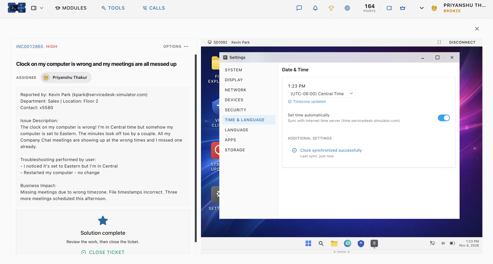

# Incident Report: INC0012865 — Clock on my computer is wrong and my meetings are all messed up[cite: 5]

## 1. Ticket Metadata
* **Ticket ID:** INC0012865[cite: 5]
* **Priority:** High[cite: 5]
* **Status:** Solution Complete[cite: 5]
* **Assignee:** Priyanshu Thakur[cite: 5]
* **Reported By:** Kevin Park (`kpark@servicedesk-simulator.com`)[cite: 5]
* **Department & Location:** Sales | Floor 2 | Contact: x5580[cite: 5]

## 2. Issue Description
The user located in the Central Time zone reported that his workstation clock was incorrectly set to Eastern Time and was also off by several minutes[cite: 5]. As a result, all **Company Chat** calendar meetings displayed at the wrong times, causing the user to miss a scheduled meeting[cite: 5].

## 3. Preliminary Troubleshooting by User
* Identified that the system timezone was set to Eastern instead of Central[cite: 5].
* Restarted the computer, which did not resolve the timezone or clock drift[cite: 5].

## 4. Business Impact
The user had already missed one meeting, had three additional meetings scheduled that afternoon, and was experiencing inaccurate file timestamps[cite: 5].

## 5. Investigation & Resolution
1. Established a remote desktop connection (`SD1092`) to Kevin Park's workstation[cite: 5].
2. Opened **Settings > Time & Language > Date & Time**[cite: 5].
3. Updated the system timezone dropdown to **`(UTC-06:00) Central Time`** and confirmed the `Timezone updated` status[cite: 5].
4. Enabled **Set time automatically** to synchronize with the internal NTP server (`time.servicedesk-simulator.com`)[cite: 5].
5. Verified under **Additional Settings** that `Clock synchronized successfully (Last sync: just now)` at `1:23 PM`[cite: 5].

## 6. Resolution Screenshot

